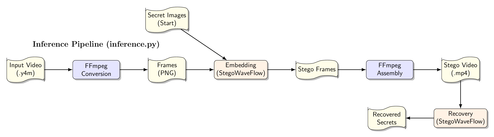
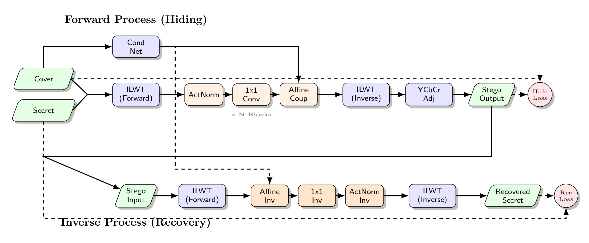

# StegoWaveFlow: High-Quality Video Steganography

**StegoWaveFlow** is a tool for hiding data in videos. It uses **Invertible Neural Networks (INNs)** and **Integer Discrete Wavelet Transforms (ILWT)** to hide images inside videos while keeping high quality.

This repository contains the code for training and using the model.

## Main Features

- **High Capacity**: Hide full-size secret images (24 bits per pixel).
- **High-Quality Recovery**: Get your hidden data back with minimal loss of detail.
- **Strong Hiding**: Uses frequency domain methods (ILWT) to keep data safe.
- **Clean Code**: Organized structure that is easy to understand and change.

---

## Installation

### What you need

- Python 3.8+
- PyTorch (1.8+)
- FFmpeg (For video processing)

### Setup

1. **Clone the project:**

   ```bash
   git clone <repository-url>
   cd StegoWaveFlow
   ```

2. **Install requirements:**

   ```bash
   pip install -r requirements.txt
   ```

   _(Make sure `torch`, `torchvision`, `numpy`, `tqdm`, and `Pillow` are installed)_

3. **Model Weights:**
   Put the pre-trained model file `ilwt_steganography_model_research.pth` in the main folder.

---

## Usage

The project has two main scripts: **inference.py** (to hide/recover data) and **train.py** (to train the model).

### 1. Using the Model (inference.py)



Use `inference.py` to hide secret images in videos and then recover them.

**How to run (Step-by-Step):**
The script will guide you through each step. This is the default mode.

```bash
python3 inference.py --y4m video.y4m
```

**Secrets Folder:**
Put the images you want to hide in the `secrets/` folder. The tool will pick images from here to hide in the video.

**Video Processing:**
The tool automatically converts **Y4M** videos to high-quality MP4 file.

**Output:**
Results are saved in a folder named `[video_name]_output/`:

- `stego_video.mp4`: The video with hidden data.
- `results.txt`: A summary of file sizes and time taken.
- `recovered/`: The secret images recovered from the video.

---

### 2. Training the Model (train.py)



Use `train.py` to train your own version of the `StegoWaveFlow` model.

**Steps:**

1.  **Train**: Run `python3 train.py`. This uses your images to teach the model.
2.  **Save**: The best model is saved as `ilwt_steganography_model_research.pth`.
3.  **Use**: You can then use this file with `inference.py`.

```bash
python3 train.py
```

- **Data**: Put your training images in the `training_data/` folder.
- **Progress**: The script shows training progress and scores in the console.
- **Checkpoints**: Saved in the `checkpoints/` folder.

---

## Project Structure

```text
.
├── core/                   # Main Logic
│   ├── config.py           # Settings
│   └── models.py           # Model definitions
├── shell/                  # Tools and Helpers
│   ├── io.py               # File reading and writing
│   └── pipeline_runner.py  # Running the process
├── inference.py            # Main tool for hiding/recovering
├── train.py                # Tool for training
├── requirements.txt        # Python libraries needed
└── README.md               # Instructions
```
